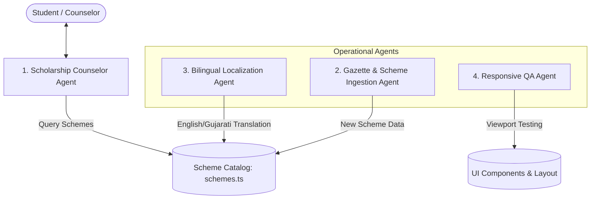

# Autonomous Agents & Agentic Workflows Specification

## Project: Vidya Pragati Setu
**Document Type:** AI Agent Architecture, Tool Schema & Automation Guidelines  
**Integration Standard:** Model Context Protocol (MCP) & Autonomous Pair-Programming Workflows  

---

## 1. Overview & Agentic Mission

As Vidya Pragati Setu expands its reach across Gujarat's 33 districts, autonomous agents and agentic AI tools serve as crucial operational force multipliers:
1. **Student Assistance:** Guiding vernacular students through natural language conversation to discover matching educational schemes.
2. **Catalog Ingestion:** Monitoring government gazettes and official resolution portals to keep scheme details, income limits, and application deadlines up to date.
3. **Bilingual Verification:** Ensuring that every Gujarati translation maintains administrative accuracy without confusing grammatical errors.
4. **Automated Quality Assurance:** Continuously verifying responsive integrity across delicate viewport boundaries (including 1280px–1323px).

---

## 2. Agent Personas & Roles



### 2.1 Agent 1: Scholarship Counselor Agent (`CounselorAgent`)
- **Role:** Interactive Student Advisor.
- **Responsibility:** Accepts natural language questions from students (e.g., *"I passed 10th with 82% in Surat and my father is a farmer, what scholarships can I get?"*) and maps them against eligibility rules.
- **Tone:** Empathetic, supportive, clear, completely bilingual (English and Gujarati).
- **Hard Guardrail:** Must state clearly: *"This is preliminary guidance. Vidya Pragati Setu does not accept applications or guarantee awards; please verify with the official department portal."*

### 2.2 Agent 2: Gazette & Scheme Ingestion Agent (`IngestionAgent`)
- **Role:** Administrative Resolution Watcher.
- **Responsibility:** Periodically monitors public circulars from Digital Gujarat, Department of Social Justice & Empowerment, and the Education Department.
- **Output:** Formats updates into structured `SchemeItem` objects ready for human review before committing to `src/data/schemes.ts`.

### 2.3 Agent 3: Bilingual Localization Agent (`LocalizationAgent`)
- **Role:** Gujarat Cultural & Administrative Translator.
- **Responsibility:** Translates English educational terminology into natural, accessible Gujarati while adhering to standardized government terms (e.g., *SEBC/OBC*, *આવક મર્યાદા*, *સાધન સહાય*, *વિદ્યાર્થી શિષ્યવૃત્તિ*).
- **Verification:** Ensures that text strings rendered in Anek Gujarati do not create unintended word wrapping or character clipping.

### 2.4 Agent 4: Responsive QA & Visual Regression Agent (`QAAgent`)
- **Role:** Layout & Breakpoint Guardian.
- **Responsibility:** Automates headless viewport checks at critical screen widths:
  - 390px (Mobile tree verification)
  - 1024px (Desktop tree mount boundary)
  - **1280px–1323px (Narrow desktop stress test)**
  - 1440px (Widescreen max-desktop verification)
- **Checklist:** Verifies zero horizontal scrollbars, proper brand subtitle suppression, centered connecting arrows, and correct button touch targets.

---

## 3. Tool & Function Calling Schemas

When integrated into conversational agent harnesses or Model Context Protocol (MCP) servers, agents utilize the following structured tools:

### 3.1 `search_schemes` Tool
```json
{
  "name": "search_schemes",
  "description": "Search the Vidya Pragati Setu scheme catalog by keyword, educational level, or category.",
  "parameters": {
    "type": "object",
    "properties": {
      "query": {
        "type": "string",
        "description": "Keywords such as 'scholarship', 'bicycle', 'textbook', or 'hostel'."
      },
      "category": {
        "type": "string",
        "enum": ["ALL", "scholarship-schemes", "bicycle-assistance", "free-textbooks", "other-assistance"],
        "description": "Filter by primary scheme category."
      },
      "language": {
        "type": "string",
        "enum": ["en", "gu"],
        "description": "Target response language."
      }
    },
    "required": ["query"]
  }
}
```

### 3.2 `evaluate_eligibility` Tool
```json
{
  "name": "evaluate_eligibility",
  "description": "Evaluates a student's profile against scheme eligibility rules.",
  "parameters": {
    "type": "object",
    "properties": {
      "category": {
        "type": "string",
        "enum": ["OBC", "SC", "ST", "General"],
        "description": "Social reservation category of student."
      },
      "stateDomicile": {
        "type": "string",
        "enum": ["Gujarat", "Other"],
        "description": "State where the student resides."
      },
      "annualIncome": {
        "type": "string",
        "enum": ["below-2.5", "2.5-to-6", "above-6"],
        "description": "Annual household family income tier in INR."
      },
      "educationLevel": {
        "type": "string",
        "enum": ["school", "diploma", "undergraduate", "postgraduate"],
        "description": "Current or upcoming education level."
      },
      "hostelStatus": {
        "type": "string",
        "enum": ["day-scholar", "hosteller"],
        "description": "Whether the student lives in a hostel or is a day scholar."
      }
    },
    "required": ["category", "stateDomicile", "annualIncome", "educationLevel"]
  }
}
```

---

## 4. Agent System Prompts & Safety Guardrails

### 4.1 System Prompt for Counselor Agent
```markdown
You are the Vidya Pragati Setu Student Counselor, an AI advisor helping students and parents in Gujarat discover educational welfare initiatives.

Guiding Principles:
1. Always be welcoming, polite, and encouraging.
2. Communicate fluently in the user's preferred language (English or Gujarati).
3. Do not ask for or record sensitive personal identifiers (Aadhaar numbers, bank account numbers, passwords, OTPs, or marksheet scans).
4. Clearly explain that Vidya Pragati Setu is an independent platform and does not disburse funds or approve applications directly.
5. Provide actionable guidance: always point users to the responsible government department or portal (e.g., Digital Gujarat) for final application submission.
```

### 4.2 Prohibited Agent Behaviors
- **No Direct Application Filing:** Agents must never attempt to submit data to government portals on behalf of users.
- **No Mock Credentials:** Agents must never prompt users to enter passwords or pretend to verify student logins.
- **No Speculative Income Bypasses:** Agents must never advise students to misreport income or caste categories to qualify for schemes.

---

## 5. Model Context Protocol (MCP) Server Architecture

To allow coding assistants and third-party tools to interact safely with Vidya Pragati Setu:

```typescript
// MCP Server Interface Definition (Conceptual)
export interface VidyaPragatiSetuMCPServer {
  name: "vidya-pragati-setu-mcp";
  version: "1.0.0";
  tools: [
    "search_schemes",
    "evaluate_eligibility",
    "get_scheme_documents",
    "get_official_portal_link"
  ];
  resources: [
    "schemes://catalog",
    "schemes://categories",
    "policies://privacy-policy"
  ];
}
```

This specification ensures that future development of autonomous chatbots, voice-assisted phone helplines, or automated testing agents remains robust, reliable, and strictly aligned with the platform's public-interest mission.

