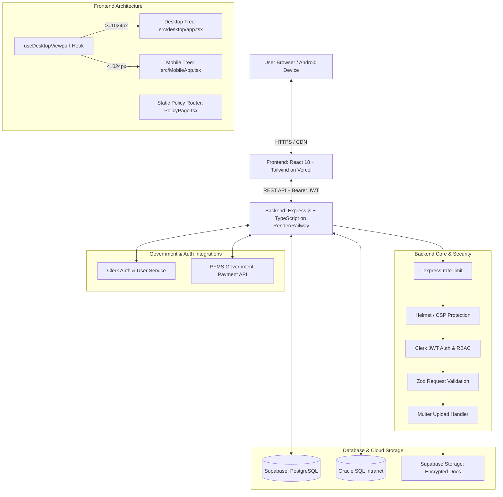

# Technical Architecture Document

## Project: Vidya Pragati Setu
**Document Type:** System Architecture & Technical Design Specification  
**Architecture Style:** Full-Stack Architecture — React Frontend SPA + Node.js/Express REST Backend  
**Deployment Target:** Vercel (Frontend) + Render / Railway (Backend) + Supabase (PostgreSQL & Storage)  

---

## 1. High-Level System Architecture

Vidya Pragati Setu is engineered with a clean separation of concerns:
- **Frontend Layer (Vercel):** An ultra-fast, responsive React SPA with dual-tree viewport routing (Android mobile `<1024px` vs Desktop `≥1024px`), optimized for vernacular Gujarati and English.
- **Backend API Layer (Render / Railway):** A secure, modular Express.js service built in TypeScript, handling authentication validation, Zod request sanitization, multipart document processing, and government integrations.
- **Data & Storage Layer (Supabase & Oracle SQL):** Scalable PostgreSQL database with Supabase Storage for encrypted student document attachments, with Oracle SQL compatibility for state intranet systems.
- **External Integration Services:** Clerk for authentication and user lifecycle management; PFMS (Public Financial Management System) for official Direct Benefit Transfer (DBT) disbursement status tracking.



---

## 2. Technology Stack & Dependencies

### 2.1 Frontend Stack (Deployed on Vercel)

| Layer | Technology | Version | Purpose / Rationale |
|---|---|---|---|
| **Core Framework** | React | `^18.3.1` | Declarative UI, StrictMode support, concurrent rendering |
| **Language** | TypeScript | `^5.5.4` | Strict typing across data models, components, and props |
| **Bundler & Tooling**| Vite | `^5.4.1` | Instant HMR, Rolldown/ESBuild bundling, static HTML asset generation |
| **CSS Utility Engine**| Tailwind CSS | `^3.4.10` | Utility-first styling with custom theme tokens & breakpoints |
| **PostCSS** | Autoprefixer | `^10.4.20` | Cross-browser vendor prefixing |
| **Animations** | Framer Motion | `^11.3.19` | Hardware-accelerated modal transitions and layout animations |
| **Iconography** | Lucide React | `^0.427.0` | Accessible SVG icon suite |

### 2.2 Backend Stack (Deployed on Render / Railway)

| Layer | Technology | Details / Role |
|---|---|---|
| **Language** | TypeScript | Strong typing for controllers, DTOs, and database entities |
| **Runtime** | Node.js | Asynchronous, event-driven runtime (LTS) |
| **Framework** | Express.js | Modular REST API routing, controllers, and middleware |
| **Validation** | Zod | Schema validation for all incoming request bodies and query parameters |
| **Security** | Rate Limiting, Helmet, CSP | `express-rate-limit`, `helmet` Content Security Policy, SQL injection prevention |
| **File Handling** | Multer | Multipart/form-data upload pipeline for marksheets, income and caste certificates |
| **Authentication**| Clerk API | User management, session handling, and RS256 JWT verification |
| **Authorization** | RBAC Middleware | Role verification (`Student`, `Institute`, `District Officer`, `Admin`) |
| **Govt Payments** | PFMS API | Direct Benefit Transfer (DBT) verification and scholarship payment tracking |
| **Database** | PostgreSQL | Supabase-hosted SQL database; Oracle SQL compatibility for state intranet |
| **File Storage** | Supabase Storage | S3-compatible private encrypted buckets for student documents |
| **Tooling** | Postman, VS Code, Oracle Studio | Automated API testing, development, and database administration |

---

## 3. Dual-Tree Viewport Architecture

To deliver an uncompromised experience without the performance drag of heavy media-query overrides, the application utilizes separate component trees:

### 3.1 Viewport Detection Hook (`useDesktopViewport`)
Located in [src/app.tsx](file:///c:/Users/Admin/Desktop/Rudra/hackathon/VPS%20Final/vidya-pragati-setu-release/src/app.tsx):

```typescript
const DESKTOP_QUERY = '(min-width: 1024px)';

function useDesktopViewport(): boolean {
  const [isDesktop, setIsDesktop] = useState<boolean>(() => {
    if (typeof window === 'undefined') return true;
    return window.matchMedia(DESKTOP_QUERY).matches;
  });

  useEffect(() => {
    const mediaQuery = window.matchMedia(DESKTOP_QUERY);
    const updateViewport = (event: MediaQueryListEvent) => setIsDesktop(event.matches);
    setIsDesktop(mediaQuery.matches);
    mediaQuery.addEventListener('change', updateViewport);
    return () => mediaQuery.removeEventListener('change', updateViewport);
  }, []);

  return isDesktop;
}
```

### 3.2 Tree Separation Benefits
1. **Zero DOM Duplication:** Prevents duplicate HTML element IDs on the page, avoiding duplicate ARIA landmarks.
2. **Device-Specific Optimization:** Mobile components can employ touch targets (`touch-target`, 44px min), swipe gestures, and drawer overlays; Desktop components can leverage wide grids, hover effects, and keyboard shortcuts.
3. **Clean Code Separation:** Desktop-specific modifications (like 1280px–1323px adjustments) remain completely isolated from the mobile experience.

---

## 4. Component Structure & Hierarchy

```
src/
├── app.tsx                         # Root Controller (Viewport & Policy router)
├── main.tsx                        # React DOM client root
├── index.css                       # Tailwind directives, CSS variables & glass surfaces
├── MobileApp.tsx                   # Dedicated Android / Mobile Experience (<1024px)
├── components/                     # Mobile & Shared Components
│   ├── BenefitsSection.tsx         # Mobile Benefits layout
│   ├── Dropdown.tsx                # Accessible Glass Dropdown
│   ├── EligibilityChecker.tsx      # 3-Step Wizard Engine
│   ├── Footer.tsx                  # Mobile Accordion Footer
│   ├── HeroSection.tsx             # Mobile Hero with Floating Stat
│   ├── HowItWorks.tsx              # Mobile Step Accordion
│   ├── LoginModal.tsx              # Informational Access Modal
│   ├── Navbar.tsx                  # Mobile App Bar & Drawer
│   ├── NotificationToast.tsx       # Accessible Animated Toast
│   ├── SchemeCard.tsx              # Mobile Scheme Card
│   ├── SchemesSection.tsx          # Mobile Scheme Grid & Filter
│   └── Skeleton.tsx                # Shimmer Loader Surface
├── desktop/                        # Dedicated Desktop Experience (≥1024px)
│   ├── app.tsx                     # Desktop Main Page Controller
│   ├── components/                 # Desktop-Specific Components
│   │   ├── BenefitsSection.tsx     # 4-Column Neumorphic Grid
│   │   ├── EligibilityResourcesPanel.tsx # Side-by-Side Checker & Resources
│   │   ├── Footer.tsx              # 5-Column Detailed Footer
│   │   ├── HeroSection.tsx         # Desktop Hero with Glass Badge
│   │   ├── HowItWorks.tsx          # 4-Column Step Flow with Arrows
│   │   ├── LatestUpdates.tsx       # Real-time Notice Cards
│   │   ├── MetricsStrip.tsx        # Aligned 4-Column Metrics Bar
│   │   ├── Navbar.tsx              # Floating Pill Glass Navbar
│   │   └── SchemeCard.tsx          # Desktop Card with Watermark Icon
│   └── lib/utils.ts                # Smooth Scrolling & Class Merging
├── data/
│   ├── schemes.ts                  # Bilingual Scheme Catalog & Metric Definitions
│   └── siteContent.ts              # FAQ, Updates, and Policy Metadata
└── pages/
    └── PolicyPage.tsx              # Static Statutory Documents Renderer
```

---

## 5. Data Flow & State Management

### 5.1 Local & Lifted State
The application avoids third-party global state libraries (Redux, Zustand) in favor of lightweight React primitives:
- `language` (`'en' | 'gu'`): Lifted to `App.tsx` and propagated to children. Changing language updates `document.documentElement.lang`.
- `searchQuery` & `activeCategoryFilter`: Lifted to `SchemesSection.tsx` and synchronised with the header search box.
- `selectedScheme` (`SchemeItem | null`): Controls the visibility and content of the scheme details modal dialog.
- `toastMessage` (`string | null`): Managed via `useCallback` with auto-dismiss timers (4.8 seconds).

### 5.2 Client-Side Search Engine
The search algorithm performs non-blocking, multi-field substring matching:

```typescript
const q = searchQuery.trim().toLowerCase();
const matches = schemes.filter(scheme => {
  return (
    scheme.title.toLowerCase().includes(q) ||
    scheme.description.toLowerCase().includes(q) ||
    scheme.categoryTag.toLowerCase().includes(q) ||
    scheme.targetGroup.toLowerCase().includes(q) ||
    scheme.titleGu.includes(q) ||
    scheme.descriptionGu.includes(q)
  );
});
```

---

## 6. Static Routing for Policies

To support direct statutory links (`/policies/privacy-policy`, etc.) without a full-blown router library:
1. `getPolicySlug(pathname)` parses `window.location.pathname`.
2. `App.tsx` renders `PolicyPage.tsx` when a slug matches.
3. `popstate` listeners ensure forward and back browser navigation work seamlessly.
4. On static hosts like Vercel, `vercel.json` rewrites all sub-routes to `/index.html`:

```json
{
  "rewrites": [
    { "source": "/(.*)", "destination": "/index.html" }
  ]
}
```

---

## 7. Security, Privacy & Compliance Architecture

- **Zero Data Collection:** No forms submit data to external web servers.
- **Content Security:** No untrusted third-party scripts or ad networks loaded.
- **Font Optimization:** Google Fonts loaded over HTTPS with `preconnect` directives.
- **Statutory Alignment:** Architecture satisfies DPDP Act 2023 principles of purpose limitation and data minimization.

