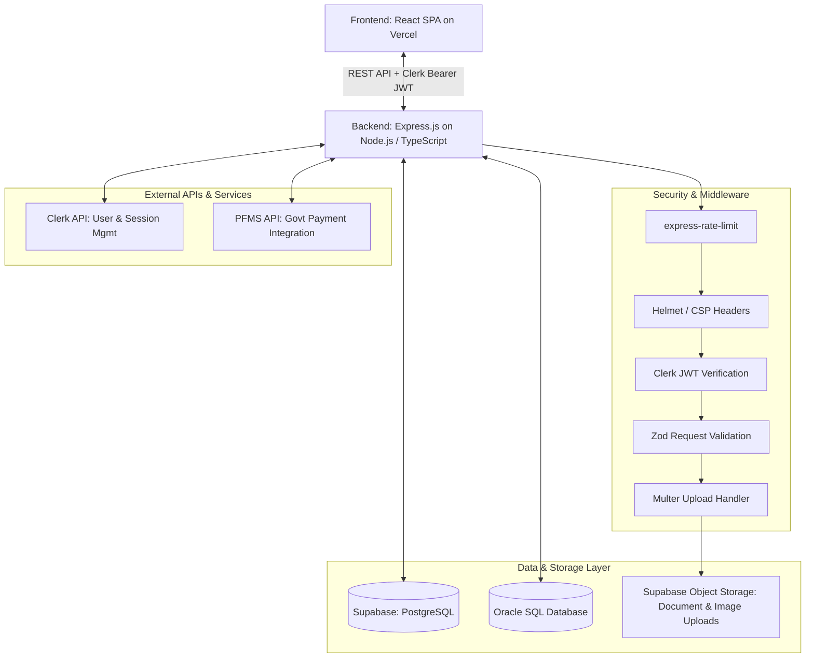

# Backend Architecture & Technical Stack Specification

## Project: Vidya Pragati Setu (વિદ્યા પ્રગતિ સેતુ)
**Document Type:** Backend Engineering & API Infrastructure Specification  
**Architecture Style:** Modular RESTful API Service with Micro-Integrations  
**Deployment Target:** Render / Railway (Backend Service) + Supabase (PostgreSQL & Storage)  

---

## 1. High-Level Backend Topology



---

## 2. Core Backend Technologies

| Component | Technology | Rationale & Configuration |
|---|---|---|
| **Language** | **TypeScript** (`5.x`) | End-to-end type safety shared across models, requests, and DTOs |
| **Runtime** | **Node.js** (`>= 20 LTS`) | Event-driven, asynchronous I/O optimized for concurrent API workloads |
| **Web Framework**| **Express.js** (`4.x` / `5.x`) | Lightweight, production-proven HTTP framework with rich middleware support |
| **Schema Validation**| **Zod** (`^3.23`) | Strict runtime type inference and request body/query validation |
| **File Handling**| **Multer** (`^1.4.5`) | Multipart/form-data handler for student documents, caste certificates, and marksheets |
| **Security Layer**| **Rate Limiter, Helmet, SQL Sanitization** | `express-rate-limit`, `helmet` (CSP), parameterized SQL queries |

---

## 3. APIs & Integrations

### 3.1 REST API Architecture
The backend exposes clean RESTful endpoints organized under `/api/v1/`:

```
/api/v1/
├── /auth/             # Session handshake and profile sync with Clerk
├── /schemes/          # Scheme catalog, filtering, and criteria management
├── /eligibility/      # Server-side verified evaluation & matching
├── /applications/     # Application draft, submission, and status lifecycle
├── /documents/        # Multipart uploads handled via Multer to Supabase Storage
├── /institutes/       # Institute verification and student endorsement
├── /disbursements/    # PFMS disbursement tracking and status reconciliation
└── /admin/            # District officer & administrative analytics
```

### 3.2 Clerk API (Authentication & User Management)
- **Primary Auth Provider:** Clerk (`@clerk/clerk-sdk-node` or `@clerk/express`).
- **Token Verification:** Extracts and verifies the cryptographic RS256 Bearer JWT on protected routes.
- **Webhook Integration:** Listens to `user.created`, `user.updated`, and `user.deleted` webhooks to keep the Supabase/Oracle user profile database in sync.

### 3.3 PFMS API (Public Financial Management System)
- **Purpose:** Official Government Payment & Direct Benefit Transfer (DBT) Integration.
- **Access Level:** Requires certified government portal access keys and IP whitelisting.
- **Functions:**
  - `verifyBankAccount(accountNo, ifscCode)`: Bank account validation via PFMS portal.
  - `trackDisbursementStatus(applicationId, pfmsTransactionId)`: Query DBT disbursement status.
  - `reconcilePaymentLogs()`: Nightly batch reconciliation of government scholarship grants.

---

## 4. Database Architecture & Storage

### 4.1 SQL Database Engine
- **Primary Database:** **PostgreSQL** hosted on **Supabase**.
- **Alternative / Enterprise Enterprise:** **Oracle (SQL)** database for government intranet interoperability.
- **Connection Management:** Connection pooling via PgBouncer (Supabase) or `oracledb` connection pool.
- **Security:** Parameterized queries to guarantee 100% SQL injection prevention.

### 4.2 Supabase Storage (Object Store)
- **Bucket Organization:**
  - `documents-private`: Encrypted storage for caste certificates, income certificates, and marksheets (accessible only via signed URLs).
  - `scheme-assets-public`: Public bucket for scheme circulars, gazette PDFs, and institutional logos.
- **Multer Workflow:**
  1. Student uploads file via frontend multipart form.
  2. Multer buffers file in memory (`memoryStorage`) with strict file size (< 5MB) and MIME-type filters (PDF, JPEG, PNG only).
  3. Backend uploads sanitized buffer to Supabase Storage bucket and stores the resulting resource path in PostgreSQL.

---

## 5. Authentication, Authorization & User Roles

### 5.1 Role-Based Access Control (RBAC) Matrix

Vidya Pragati Setu defines 4 discrete user roles:

| Feature / Resource | Student | Institute | District Officer | Admin |
|---|:---:|:---:|:---:|:---:|
| Search & Browse Schemes | Read | Read | Read | Full |
| Check Eligibility | Execute | Execute | Execute | Execute |
| Submit Scholarship Application | Create / Edit (Own) | No | No | Read (Audit) |
| Upload Verification Documents | Upload (Own) | No | No | Read (Audit) |
| Endorse / Verify Student Admission | No | Verify / Reject | Read | Read |
| District-Level Scheme Scrutiny | No | No | Approve / Forward | Read |
| PFMS Payment Reconciliation | No | No | Read Status | Trigger / Reconcile |
| Manage Scheme Catalog & Policies | No | No | No | Full CRUD |
| User Role Assignment | No | No | No | Full Admin |

### 5.2 JWT Verification Middleware Pattern
```typescript
import { Request, Response, NextFunction } from 'express';
import { ClerkExpressRequireAuth } from '@clerk/clerk-sdk-node';

export interface AuthenticatedRequest extends Request {
  auth?: {
    userId: string;
    sessionId: string;
    claims: {
      role: 'Student' | 'Institute' | 'District Officer' | 'Admin';
      email: string;
    };
  };
}

export const requireRole = (allowedRoles: string[]) => {
  return (req: AuthenticatedRequest, res: Response, next: NextFunction) => {
    const userRole = req.auth?.claims?.role;
    if (!userRole || !allowedRoles.includes(userRole)) {
      return res.status(403).json({
        error: 'Forbidden',
        message: 'You do not have permission to access this resource.'
      });
    }
    next();
  };
};
```

---

## 6. Security Infrastructure & Compliance

### 6.1 Rate Limiting (`express-rate-limit`)
- **Global API Rate Limit:** 100 requests per 15 minutes per IP address.
- **Sensitive Endpoints (`/api/v1/auth/*`, `/api/v1/documents/upload`):** 10 requests per 10 minutes to mitigate brute-force and DoS risks.

### 6.2 Content Security Policy (CSP) & Headers (`helmet`)
- Strict `default-src 'self'`.
- Script & style hashes pinned; strict iframe embedding denial (`X-Frame-Options: DENY`).
- HSTS enabled with `max-age=31536000; includeSubDomains; preload`.

### 6.3 Zod Input Sanitization Example
```typescript
import { z } from 'zod';

export const EligibilityCheckSchema = z.object({
  category: z.enum(['OBC', 'SC', 'ST', 'General']),
  stateDomicile: z.enum(['Gujarat', 'Other']),
  annualIncome: z.enum(['below-2.5', '2.5-to-6', 'above-6']),
  educationLevel: z.enum(['school', 'diploma', 'undergraduate', 'postgraduate']),
  institutionType: z.enum(['government', 'grant-in-aid', 'self-financed']),
  hostelStatus: z.enum(['day-scholar', 'hosteller']),
});
```

---

## 7. Deployment & Hosting Architecture

| Subsystem | Hosting Platform | URL Pattern / DNS |
|---|---|---|
| **Frontend SPA** | **Vercel** | `https://vidyapragatisetu.gujarat.gov.in` (or `.org`) |
| **Backend REST Service** | **Render / Railway** | `https://api.vidyapragatisetu.org` |
| **Database & Auth** | **Supabase (PostgreSQL) + Clerk** | Direct connection pooler (`pgbouncer.supabase.co:6543`) |
| **Object Store** | **Supabase Storage** | S3-compatible private/public storage buckets |
| **Source Control** | **Git & GitHub** | Branching: `main` (Production), `staging` (QA / Testing) |

---

## 8. Development & Tooling Ecosystem

- **IDE:** Visual Studio Code (VS Code) with recommended ESLint, Prettier, and Prisma/SQL extensions.
- **API Testing & Mocking:** Postman (Collection workspace with automated regression test runs).
- **Package Manager:** `npm` (Node Package Manager).
- **Database Management & Querying:**
  - Supabase Studio (Web GUI for PostgreSQL tables, RLS policies, and storage).
  - Oracle SQL Developer / Oracle Studio (for enterprise Oracle SQL interoperability).

